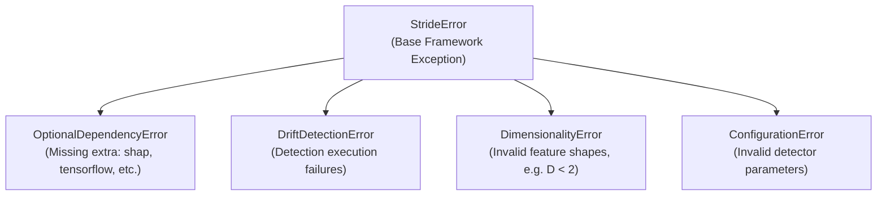

# Exception Hierarchy

The `stride.exceptions` module defines domain exceptions for the STRIDE framework, ensuring precise error reporting and clear diagnostic messaging.

---

## Overview

All framework exceptions derive from `StrideError`. Specific subclasses are raised to indicate missing optional dependencies, invalid dimensionalities, mathematical errors, or configuration issues:



```python
from stride.exceptions import (
    StrideError,
    OptionalDependencyError,
    DriftDetectionError,
    DimensionalityError,
    ConfigurationError,
)
```

### Exception Reference

| Exception | Base Class | Trigger Condition |
| :--- | :--- | :--- |
| `StrideError` | `Exception` | Root exception for all errors raised within STRIDE. |
| `OptionalDependencyError` | `StrideError` | Raised when an optional extra (e.g. `shap`, `tensorflow`, `hdbscan`) is requested but not installed in the current environment. |
| `DriftDetectionError` | `StrideError` | Raised when drift calculations fail due to degenerate data streams or calculation divergence. |
| `DimensionalityError` | `StrideError` | Raised when input matrices violate algorithm dimension constraints (e.g. attempting 2D boundary projections with fewer than 2 features). |
| `ConfigurationError` | `StrideError` | Raised when invalid algorithm parameters or contradictory configurations are supplied. |

---

## API Specification

::: stride.exceptions
