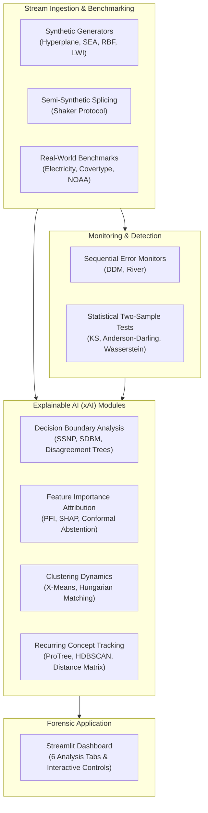

# STRIDE: STReam Insight and Drift Explanation

A Python Toolkit for Concept Drift Detection, Characterization, and Explanation

[](https://michalredm.github.io/stride-website/assets/pdf/paper.pdf)
[](https://link.springer.com/chapter/10.1007/978-3-032-37685-5_32)
[](https://pypi.org/project/stride-xai/)
[](https://pypi.org/project/stride-xai/)
[](https://michalredm.github.io/stride-website/)
[](https://stream-insight-and-drift-explanation.streamlit.app/)
[](https://github.com/KubaCzech/STRIDE/blob/main/LICENSE)

---

## Overview

In streaming machine learning, non-stationarity degrades predictive performance when data distributions evolve over time. Traditional drift detectors (such as DDM, EDDM, or ADWIN) output binary alerts when error rates increase, treating both data generators and predictive models as black boxes. Consequently, operators receive notifications that performance dropped, but lack diagnostic insight into **how** distributions changed, **which** features drove the shift, or **where** decision boundaries deteriorated.

**STRIDE** (*STReam Insight and Drift Explanation*) addresses this diagnostic limitation. Presented at **ECML PKDD 2026** (Demo Track), STRIDE is an open-source framework and interactive Streamlit application that analyzes streaming shifts across three concurrent layers:

1. **Data Layer** (*How*): Evaluates covariate shifts $P(X)$ through non-parametric two-sample hypothesis tests, summary distribution divergences, and dynamic clustering independent of model outputs.
2. **Model Layer** (*When*): Monitors sequential classification error streams and applies change-point localization algorithms to identify drift onset points and duration.
3. **Explanation Layer** (*Where & Why*): Adapts Explainable AI (xAI) techniques to project decision boundary migrations in 2D, isolate drift-inducing features via temporal discriminators, and cluster recurring concept regimes.

Unlike post-hoc analysis pipelines that trigger explanations only after significant performance degradation, STRIDE executes a **synchronous pipeline** that inspects reference and detection windows across all three layers in parallel. This enables continuous tracking of distribution dynamics and early intervention before catastrophic model decay.

---

## Three-Layer Architecture

STRIDE decomposes stream monitoring into three specialized layers operating on sliding windows:

### 1. Data Layer (Covariate Shifts)
The data layer tracks variations in the marginal distribution $P(X)$ without model reliance:

* **Non-Parametric Hypothesis Tests**: Two-sample Kolmogorov-Smirnov (KS) and Anderson-Darling tests detect significant univariate distribution differences across windows.
* **Distribution Divergences**: First Wasserstein distance ($\mathcal{W}_1$, Earth Mover's Distance) quantifies absolute distribution displacement across continuous features.
* **Clustering Dynamics**: Dynamic X-means clustering with Bayesian Information Criterion (BIC) tracks sub-population movements, while the Hungarian algorithm computes optimal centroid displacement vectors across consecutive batches.

### 2. Model Layer (Sequential Error Tracking)
The model layer evaluates classifier behavior across the temporal stream:

* **Sequential Error Monitoring**: Integrates the River stream learning framework to track streaming error rates using algorithms like Drift Detection Method (DDM).
* **Onset & Duration Localization**: Post-detection lookback algorithms (CUSUM, threshold, and gradient) identify the precise sample where distribution divergence initiated.
* **Warning and Drift Thresholds**: Dual-threshold monitoring provides early warnings before permanent concept substitution occurs.

### 3. Explanation Layer (Model-Agnostic Interpretability)
The explanation layer localizes and characterizes the mechanics of detected drift:

* **Decision Boundary Mapping**: Self-Supervised Neighbor Projection (SSNP) trains bi-directional neural encoders mapping high-dimensional spaces to 2D latent planes, enabling visualization of decision surface deformation and surrogate disagreement decision trees.
* **Feature Importance Attribution**: Evaluates data drift ($P(X)$) versus real concept drift ($P(Y \mid X)$) using an auxiliary temporal discriminator with Permutation Feature Importance (PFI) or SHAP, reinforced by conformal selective abstention.
* **Recurring Concept Detection**: Archives window representations using prototype trees (`ProTree`), computes pairwise distance matrices, and applies HDBSCAN density clustering to discover re-emerging historical regimes.

---

## Processing Pipeline

The following diagram illustrates how STRIDE processes data streams, coordinates detection, and feeds the multi-tab interactive dashboard:



---

## Interactive Dashboard

STRIDE includes a reactive [Streamlit](https://streamlit.io/) application designed for interactive stream forensics, parameter experimentation, and research demonstrations.

* **Stream Replay & Window Stepping**: Replay streaming datasets sample-by-sample or jump directly to detected drift points.
* **Synchronous Multi-Layer Views**: Inspect data distribution shifts, error trajectories, 2D decision boundary maps, feature attribution bars, clustering displacement, and recurrence matrices side by side.
* **Interactive Dataset Stitching**: Create custom semi-synthetic drift benchmarks using the Shaker protocol via a dedicated modal interface.
* **Public Demo**: An interactive demonstration is hosted at [stream-insight-and-drift-explanation.streamlit.app](https://stream-insight-and-drift-explanation.streamlit.app/).

---

## Documentation Guide

The documentation is organized into four main sections:

| Section | Focus |
| :--- | :--- |
| [Getting Started](getting-started/installation.md) | Package installation, optional capability extras, and end-to-end quickstart tutorial. |
| [User Guide](user-guide/data-layer.md) | In-depth walkthroughs of statistical tests, sequential monitoring, boundary mapping, feature importance, clustering, recurrence, and the dashboard. |
| [Theory](theory/drift-taxonomy.md) | Formal mathematical foundations, drift taxonomies ($P(X)$ vs $P(Y \mid X)$), and algorithmic formulations. |
| [API Reference](api/datasets.md) | Autogenerated interface reference detailing signatures, parameter contracts, and return structures across all modules. |
| [Developer Guide](developer/contributing.md) | Contribution standards, local CI verification gates, and AI agent documentation invariants. |

---

## Citation

If you use STRIDE in your research, please cite our paper from the **ECML PKDD 2026 Demo Track**:

```bibtex
@inproceedings{nagorka2026stride,
  title     = {{STReam Insight and Drift Explanation (STRIDE): A Python Toolkit for Concept Drift Detection and Explanation}},
  author    = {Nag{\'o}rka, Wojciech and Redmer, Micha{\l} and Czech, Kuba and Aksoy, Deniz and Stefanowski, Jerzy},
  booktitle = {Machine Learning and Knowledge Discovery in Databases. Applied Data Science Track, Demo Track and Industrial Track (ECML PKDD)},
  series    = {Lecture Notes in Computer Science},
  pages     = {348--352},
  year      = {2026},
  publisher = {Springer, Cham},
  doi       = {10.1007/978-3-032-37685-5_32},
  url       = {https://link.springer.com/chapter/10.1007/978-3-032-37685-5_32}
}
```

---

## Authors & Acknowledgments

* **Wojciech Nagórka** &bull; Poznań University of Technology
* **Michał Redmer** &bull; Poznań University of Technology
* **Kuba Czech** &bull; Poznań University of Technology
* **Deniz Aksoy** &bull; Poznań University of Technology
* **Jerzy Stefanowski** &bull; Poznań University of Technology

**Funding**: The research by Jerzy Stefanowski was supported by the National Science Centre, Poland, under OPUS grant no. `2023/51/B/ST6/00545`.

Project Website: [https://michalredm.github.io/stride-website/](https://michalredm.github.io/stride-website/)
