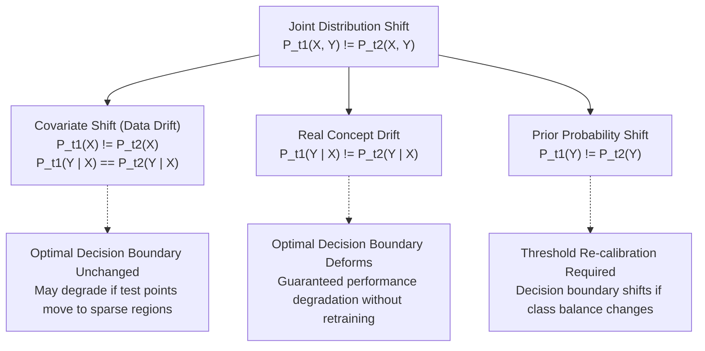

# Drift Taxonomy in Data Streams

In streaming machine learning, non-stationarity describes scenarios where the underlying data generating process evolves over time $t$. Understanding the formal decomposition of drift is essential for selecting appropriate detection mechanisms, avoiding false alarms, and designing effective model adaptation strategies.

---

## Formal Probabilistic Decomposition

Let $X \in \mathbb{R}^D$ denote a continuous or mixed feature vector and $Y \in \{0, 1, \dots, C-1\}$ denote the categorical target label. At any time step $t$, instances are sampled from a joint probability distribution $P_t(X, Y)$.

Applying Bayes' theorem, the joint distribution decomposes in two symmetric forms:

$$P_t(X, Y) = P_t(X) \cdot P_t(Y \mid X)$$

and

$$P_t(X, Y) = P_t(Y) \cdot P_t(X \mid Y)$$

where:
* $P_t(X)$ is the **marginal feature distribution** (input space density).
* $P_t(Y \mid X)$ is the **posterior probability distribution** (the true mapping from features to labels).
* $P_t(Y)$ is the **prior class distribution** (class balance).
* $P_t(X \mid Y)$ is the **class-conditional feature distribution** (the distribution of features within each class).

A data stream experiences distribution drift between two time steps $t_1$ and $t_2$ if and only if:

$$P_{t_1}(X, Y) \neq P_{t_2}(X, Y)$$

---

## Classification of Drift Types

Depending on which terms of the probabilistic decomposition alter between $t_1$ and $t_2$, drift is categorized into three primary types:



### 1. Covariate Shift (Virtual Drift / Data Drift)
Occurs when the marginal input distribution changes while the posterior relationship to labels remains stationary:

$$P_{t_1}(X) \neq P_{t_2}(X) \quad \text{and} \quad P_{t_1}(Y \mid X) = P_{t_2}(Y \mid X)$$

* **Diagnostic Signature**: Flagged strongly by the Data Layer (KS test, Anderson-Darling, Wasserstein distance).
* **System Impact**: The mathematically optimal decision boundary does not change. However, if the support of $P(X)$ shifts into regions of feature space where the training set had low density, classifier confidence drops and inductive generalization error may increase.
* **Remediation**: Sample reweighting (importance weighting) or active data collection in newly populated regions, without necessarily retraining the entire hypothesis class.

### 2. Real Concept Drift (Posterior Drift)
Occurs when the relationship between features and target labels changes over time:

$$P_{t_1}(Y \mid X) \neq P_{t_2}(Y \mid X)$$

* **Diagnostic Signature**: Detected by the Model Layer (breached DDM error thresholds) and isolated by the Explanation Layer (elevated importance under $Z = [X, Y]$ temporal discrimination and expanded disagreement regions).
* **System Impact**: The true decision boundary alters. A stationary model trained on $t_1$ is guaranteed to suffer persistent classification errors on $t_2$.
* **Remediation**: Replacing or fine-tuning the predictive model using recently acquired ground-truth labeled instances.

### 3. Prior Probability Shift
Occurs when the class distribution $P(Y)$ alters independently of feature properties:

$$P_{t_1}(Y) \neq P_{t_2}(Y) \quad \text{and} \quad P_{t_1}(X \mid Y) = P_{t_2}(X \mid Y)$$

* **Diagnostic Signature**: Changes in observed confusion matrices and class ratios over time.
* **System Impact**: Shifts the Bayesian decision threshold:
  $$\frac{P(Y=1 \mid X)}{P(Y=0 \mid X)} = \frac{P(X \mid Y=1)}{P(X \mid Y=0)} \cdot \frac{P(Y=1)}{P(Y=0)}$$
* **Remediation**: Re-calibrating classification thresholds or adjusting cost matrices without full feature retraining.

---

## Temporal Transition Patterns

Drift processes exhibit distinct temporal velocity profiles:

```text
Sudden / Abrupt:
Concept A: ───────┐
Concept B:        └─────────────── (instantaneous switch at t0)

Gradual:
Concept A: ───────\
Concept B:         \────────────── (smooth sigmoidal mixing probability)

Incremental:
Concept:   ───────/───────/─────── (continuous multi-step trajectory)

Recurring:
Concept A: ───────\      /───────\ (cyclical / re-emerging historical regimes)
Concept B:         \────/         \────
```

### 1. Sudden (Abrupt) Drift
An instantaneous concept substitution at a discrete change-point $t_0$. Instances sampled prior to $t_0$ originate from concept $S_1$, while instances sampled at or after $t_0$ originate strictly from $S_2$.

### 2. Gradual Drift
A transition interval $[t_0, t_0 + W]$ where instances are probabilistically drawn from both the old concept $S_1$ and the new concept $S_2$. The mixing probability follows a sigmoidal schedule (*Gama et al., 2014*):

$$P(S_2 \mid t) = \frac{1}{1 + \exp\left( -s \cdot (t - t_0) \right)}$$

where $s$ governs transition steepness and $W$ denotes the window width.

### 3. Incremental Drift
A smooth, continuous migration through an infinite sequence of intermediate concepts ($S_1 \to S_{1.1} \to S_{1.2} \to \dots \to S_2$) without distinct stationary plateaus. Common in sensor calibration decay and macroeconomic inflation trends.

### 4. Recurring Drift
A previously active distribution re-emerges after an inactive period ($S_1 \to S_2 \to S_1$). Recognizing recurring concepts allows reuse of archived models rather than incurring cold-start retraining penalties.

### 5. Outliers and Stochastic Blips
Isolated anomalous instances ($P_{t}(X, Y)$ departs from $S_1$ for $1 \le \Delta t \ll W$ before returning). Robust detectors must distinguish transient blips from genuine, persistent concept changes.

---

## Layer Mapping Matrix in STRIDE

| Analytical Layer | Target Distribution | Diagnostic Tool | Primary Question Answered |
| :--- | :--- | :--- | :--- |
| **Data Layer** | $P(X)$ | KS, AD, Wasserstein, Moments | *Did input feature distributions shift?* |
| **Model Layer** | $P_t(\text{error})$ | River DDM, Error Descriptors | *When did classifier accuracy degrade?* |
| **Explanation Layer** | $P(Y \mid X)$ | SSNP, SDBM, Disagreement Trees | *Where in feature space did boundaries move?* |
| **Explanation Layer** | $[X, Y]$ vs $X$ | Temporal Discriminator (PFI / SHAP) | *Which features drove data drift vs concept drift?* |
| **Explanation Layer** | Latent Geometry | X-Means, Hungarian Matching | *How did sub-population clusters migrate?* |
| **Explanation Layer** | Multi-Window Memory | ProTree, Pairwise Distances, HDBSCAN | *Is this concept novel or recurring?* |

---

## References

1. Gama, J., Žliobaitė, I., Bifet, A., Pechenizkiy, M., & Bouchachia, A. (2014). *A survey on concept drift adaptation*. ACM Computing Surveys (CSUR), 46(4), 1-37.
2. Lu, J., Liu, A., Dong, F., Gu, F., Gama, J., & Zhang, G. (2018). *Learning under concept drift: A review*. IEEE Transactions on Knowledge and Data Engineering, 31(12), 2346-2363.
3. Webb, G. I., Hyde, R., Cao, H., Nguyen, H. L., & Petitjean, F. (2016). *Characterizing concept drift*. Data Mining and Knowledge Discovery, 30(4), 964-994.
4. Ditzler, G., Roveri, M., Alippi, C., & Polikar, R. (2015). *Learning in nonstationary environments: A survey*. IEEE Computational Intelligence Magazine, 10(4), 12-25.
