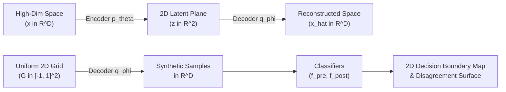

# Decision Boundary Analysis

Concept drift frequently manifests as spatial deformations in the decision boundary separating classes. STRIDE projects high-dimensional data streams into an interpretable 2D landscape and characterizes boundary shifts using neural projections and surrogate disagreement trees.

---

## Overview

Real concept drift modifies the posterior distribution $P(Y \mid X)$, which shifts or deforms the optimal separating hyperplane between classes. When monitoring streaming classifiers, visual inspection of decision boundaries reveals:

* Whether boundaries rotated, translated, or expanded.
* Which classes suffered the greatest boundary contraction.
* The specific regions of feature space where the pre-drift model $f_{\text{pre}}$ and post-drift model $f_{\text{post}}$ disagree.

However, in high-dimensional feature spaces ($D > 2$), decision surfaces cannot be plotted directly.

---

## The Dimensionality Challenge and SSNP

Standard dimensionality reduction methods (such as PCA, t-SNE, or UMAP) project data points from $\mathbb{R}^D \to \mathbb{R}^2$, but they do not provide a continuous, differentiable **inverse mapping** from the 2D projection back to the original feature space ($\mathbb{R}^2 \to \mathbb{R}^D$).

Without an inverse mapping, one cannot evaluate a trained high-dimensional classifier across a regular 2D visualization grid to reconstruct decision surfaces.

STRIDE solves this using **Self-Supervised Neighbor Projection (SSNP)** (*Espadoto et al., 2020*), a bi-directional neural network architecture:

1. **Encoder ($p_\theta: \mathbb{R}^D \to \mathbb{R}^2$)**: Projects high-dimensional feature instances into the 2D plane.
2. **Decoder ($q_\phi: \mathbb{R}^2 \to \mathbb{R}^D$)**: Reconstructs high-dimensional synthetic feature vectors from arbitrary 2D grid coordinates.



### Loss Formulation

SSNP trains both networks jointly by minimizing a composite objective:

$$\mathcal{L}(\theta, \phi) = \mathcal{L}_{\text{recon}} + \lambda_{\text{nbr}} \mathcal{L}_{\text{nbr}}$$

* **Reconstruction Loss**: Enforces cycle consistency so that projected points retain their feature attributes upon decoding:
  $$\mathcal{L}_{\text{recon}} = \frac{1}{N} \sum_{i=1}^N \left\| x_i - q_\phi(p_\theta(x_i)) \right\|_2^2$$
* **Neighbor Distance Loss**: Preserves pairwise distances among local $k$-nearest neighbors:
  $$\mathcal{L}_{\text{nbr}} = \sum_{i=1}^N \sum_{j \in \mathcal{N}_k(i)} \left( \left\| p_\theta(x_i) - p_\theta(x_j) \right\|_2 - d(x_i, x_j) \right)^2$$

Once trained, STRIDE generates a regular $M \times M$ grid in $[-1, 1]^2$, decodes all grid coordinates back to $\mathbb{R}^D$ via $q_\phi$, and queries the pre-drift and post-drift classifiers to generate Supervised Decision Boundary Maps (SDBM).

---

## Disagreement Analysis & Decision Rules

To translate visual boundary differences into human-readable explanations, STRIDE evaluates predictions across the decoded grid points and identifies the **disagreement region**:

$$\mathcal{D} = \left\{ x \in \mathbb{R}^D : f_{\text{pre}}(x) \neq f_{\text{post}}(x) \right\}$$

STRIDE fits a shallow, interpretable **Disagreement Decision Tree** to classify whether points fall into $\mathcal{D}$:

$$y_{\text{disagree}} = \mathbb{I}\left( f_{\text{pre}}(x) \neq f_{\text{post}}(x) \right)$$

Extracting the decision paths from this tree yields explicit bounding-box rules describing where the classifiers diverge (for example: `Feature 1 > 0.45 AND Feature 3 <= -0.12`).

---

## Python API Usage

The entire boundary analysis pipeline is encapsulated in `DecisionBoundaryDriftAnalyzer`:

```python
from stride.datasets import HyperplaneDriftDataset
from stride.models import MLPModel
from stride.xai.boundary import DecisionBoundaryDriftAnalyzer

# 1. Generate rotating hyperplane dataset
dataset = HyperplaneDriftDataset()
X, y = dataset.generate(
    n_samples_before=1000,
    n_samples_after=1000,
    n_features=6,
    n_drift_features=2,
    drift_width=50,
    random_seed=42,
)

X_ref, y_ref = X.iloc[:1000], y.iloc[:1000]
X_det, y_det = X.iloc[1000:], y.iloc[1000:]

# 2. Initialize analyzer
analyzer = DecisionBoundaryDriftAnalyzer(
    X_before=X_ref,
    y_before=y_ref,
    X_after=X_det,
    y_after=y_det,
    random_state=42,
)

# 3. Execute analysis
# grid_size defines visualization resolution (e.g., 200x200 grid points)
report = analyzer.analyze(
    model_class=MLPModel,
    grid_size=200,
    ssnp_epochs=15,
)

print(f"Pre-drift test accuracy:  {report['accuracy_before']:.2%}")
print(f"Post-drift test accuracy: {report['accuracy_after']:.2%}")
print(f"Disagreement region size: {report['disagreement_fraction']:.2%}")

# Access decision rules from the disagreement tree
if "tree_rules" in report:
    print("\nDisagreement Region Explanations:")
    for rule in report["tree_rules"][:3]:
        print(f"  Rule: {rule}")
```

### Visualization

To render the pre-drift and post-drift boundary maps alongside the disagreement region, use `stride.plotting`:

```python
from stride.plotting import plot_decision_boundary

fig = plot_decision_boundary(
    grid_predictions_before=report["grid_before"],
    grid_predictions_after=report["grid_after"],
    disagreement_mask=report["disagreement_mask"],
    projected_samples=report["projected_samples"],
)
# fig is a standard matplotlib.figure.Figure instance
fig.savefig("boundary_shift.png", dpi=300, bbox_inches="tight")
```

---

## Configuration Reference

| Parameter | Type | Default | Description |
| :--- | :--- | :--- | :--- |
| `model_class` | `type[BaseModel]` | `MLPModel` | Classifier wrapper class used to fit pre- and post-drift models. |
| `grid_size` | `int` | `200` | Resolution of the uniform 2D latent grid ($M \times M$ points). |
| `ssnp_epochs` | `int` | `10` | Number of training epochs for the SSNP autoencoder. |
| `passthrough_2d` | `bool` | `True` | If input data is strictly 2-dimensional ($D = 2$), bypasses neural projection and directly uses native feature coordinates. |
| `random_state` | `int` | `42` | Pseudo-random seed ensuring reproducible projections. |
