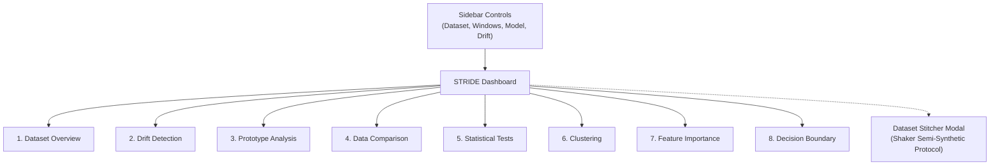

# Interactive Streamlit Dashboard

STRIDE includes a reactive [Streamlit](https://streamlit.io/) application designed for interactive stream forensics, parameter experimentation, and research demonstrations.

---

## Architectural Principles

The dashboard is structured around strict separation of concerns:

* **Decoupled Architecture**: All analytical algorithms and estimators reside under `src/stride/` without any Streamlit dependencies. The dashboard code under `dashboard/` handles exclusively UI layout, widget configuration, and state synchronization.
* **Session State Isolation**: All stream datasets, model instances, and analytical outputs are isolated per execution context in `st.session_state`.
* **Computation Gating**: Heavy computations (such as SSNP neural autoencoder training, SHAP value calculations, and distance matrix computations) are gated behind explicit calculation triggers (`st.form` and `st.fragment`) to prevent unnecessary full-page reruns on widget adjustments.

---

## Launching the Application

### 1. Installation

Ensure that the dashboard extra is installed in your virtual environment:

```bash
pip install "stride-xai[dashboard]"
```

### 2. Local Execution

Run the Streamlit application from the repository root:

```bash
streamlit run dashboard/app.py
```

The application opens by default at `http://localhost:8501`.

### 3. Hosted Online Demonstration

For quick evaluation without local installation, a public deployment is hosted on Streamlit Community Cloud:

**[stream-insight-and-drift-explanation.streamlit.app](https://stream-insight-and-drift-explanation.streamlit.app/)**

---

## Dashboard Workflow & Multi-Tab Layout

The dashboard organizes stream forensics into eight analytical tabs:



### Tab 1: Dataset Overview
* **Stream Summary**: Number of samples, features and windows, class balance, and ground-truth drift metadata of synthetic datasets (drift points, intervals, drifting features).
* **Data Preview**: The first samples of the stream and descriptive statistics of the full stream.

### Tab 2: Drift Detection
* **Online Error Trajectory**: Real-time error rate curves plotted alongside cumulative accuracy.
* **Sequential Drift Detectors**: Selectable streaming detectors including DDM, DualADWIN, EDDM, FHDDM, and HDDM with configurable confidence thresholds.
* **Statistical Warning & Drift Bands**: Displays detector thresholds, including River's DDM bounds ($p_{\min} + 2s$ warning threshold and $p_{\min} + 3s$ drift alarm threshold) and ADWIN adaptive Hoeffding bounds.
* **Onset & Duration Localization**: Renders CUSUM lookback change-point markers identifying where error acceleration initiated (`drift_start_index`) versus where the alarm was raised, with adaptive lookback window calibration bounded by detector width.

### Tab 3: Prototype Analysis
* **Window Memory Timeline**: Displays archived window representations throughout the stream lifetime.
* **Pairwise Distance Heatmaps**: Visualizes similarity matrices across all historical windows using minimal prototype distance, mean distance, or explainer tree distance.
* **HDBSCAN Regime Clustering**: Color-coded concept regime timeline grouping re-emerging historical distributions under consistent cluster identifiers.

### Tab 4: Data Comparison
* **Window Comparison**: Feature-versus-target plots (violin, box or scatter) of the Before and After windows, sample counts and class balance of both windows.
* **Descriptive Statistics**: Class-wise mean, median and standard deviation of every feature in both windows and their relative change.

### Tab 5: Statistical Tests
* **Two-Sample Tests and Distances**: Kolmogorov-Smirnov and Anderson-Darling tests and Wasserstein and Jensen-Shannon distances for every feature within every class, with configurable significance level $\alpha$ and thresholds.
* **Decision**: Share of flagged feature-class pairs per test, the number of pairs a test flags by chance without drift ($\alpha$ times the number of pairs), and the overall decision.
* **Feature Table**: p-values, KS statistic and distances per feature and class, with flagged pairs highlighted.
* **Distribution Plots**: ECDF, histogram, KDE, boxplot and two-sample Q-Q plot of a selected feature in both windows.

### Tab 6: Clustering
* **X-Means Modality Discovery**: Dynamic estimation of sub-population cluster count $K$ in reference versus detection windows.
* **Drift Decision**: Drift strength across four criteria (cluster birth/death, centroid shift, per-cluster statistics, cluster spread) with a permutation-test p-value, and a per-class table of triggered checks and their contribution to the strength.
* **Cluster Overview**: Status of every cluster (tracked, appeared, disappeared), its size in both windows, centroid shift and change of spread; per-cluster statistic changes in standard deviations; centroids.
* **Centroid Shift Vectors**: 2D plots of centroid displacement paths, identifying emerging (cluster birth) or disappearing (cluster death) sub-populations.
* **Configuration**: Range of the number of clusters, number of permutations, significance level, reference or independent (legacy) cluster matching, and optional size-aware significance tests per cluster.

### Tab 7: Feature Importance
* **Comparative Attribution Charts**: Bar plots contrasting feature attributions under Covariate Shift ($P(X)$) versus Real Concept Drift ($P(Y \mid X)$).
* **Method Selection**: Toggle between Permutation Feature Importance (PFI) and SHAP (TreeExplainer / KernelExplainer).
* **Conformal Selective Abstention**: Interactive slider controlling the significance parameter $\epsilon$ for selective discriminator prediction, displaying the abstention fraction and isolated drift attributions.

### Tab 8: Decision Boundary
* **2D Latent Projection**: Renders interactive decision surfaces generated via Self-Supervised Neighbor Projection (SSNP).
* **Supervised Decision Boundary Maps (SDBM)**: Displays side-by-side decision landscapes comparing the pre-drift reference classifier $f_{\text{pre}}$ with the post-drift detection classifier $f_{\text{post}}$.
* **Disagreement Surface & Tree Rules**: Visualizes the geometric region of disagreement and outputs human-readable surrogate decision tree rules bounding the drift zone.

---

## Interactive Dataset Stitcher

The dashboard features a built-in **Dataset Stitcher** dialog implementing the semi-synthetic concept drift protocol (*Shaker & Hüllermeier, 2015*):

1. **Source Dataset Selection**: Select two distinct datasets representing initial concept $S_1$ and subsequent concept $S_2$ (e.g. Red vs White Wine Quality).
2. **Distribution Alignment**: Select statistical alignment strategies (Wasserstein distance with optimal Hungarian bipartite assignment, manual column mapping, or shared PCA latent subspace).
3. **Transition Schedule**: Configure the transition type:
   * *Abrupt*: Instantaneous switch at sample $t_0$.
   * *Gradual*: Sigmoidal Bernoulli sampling over transition width $W$.
   * *Incremental*: Nearest-neighbor linear interpolation between concepts.
   * *Recurring*: Harmonic periodic oscillation between $S_1$ and $S_2$.
4. **Live Stream Preview & Registration**: Preview the stitched stream's transition curve, inspect ground-truth change-point markers, and register the dataset directly into active session memory.
