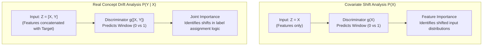

# Feature Importance Attribution

Feature attribution in STRIDE identifies which input dimensions drove observed distribution shifts and determines whether changes reflect covariate shift ($P(X)$) or real concept drift ($P(Y \mid X)$).

---

## Overview

When machine learning pipelines experience degradation, identifying the specific features responsible for performance collapse is essential for model diagnosis and remediation. 

Standard explainability methods (such as SHAP or Permutation Feature Importance) applied to the primary task classifier describe how features contribute to the current classification decision. However, they cannot directly explain the **temporal transition** between the baseline regime and the drifted state.

STRIDE introduces a **temporal discriminator** paradigm to quantify feature contributions to distribution divergence.

---

## The Temporal Discriminator Paradigm

To quantify how features changed between the reference window $W_{\text{ref}}$ ($t=0$) and the detection window $W_{\text{det}}$ ($t=1$), STRIDE trains an auxiliary binary classifier $g(Z)$:

$$\min_{g} \frac{1}{|W_{\text{ref}}| + |W_{\text{det}}|} \sum_{i} \ell\left( g(z_i), t_i \right)$$

where $t_i = 0$ for instances from $W_{\text{ref}}$ and $t_i = 1$ for instances from $W_{\text{det}}$.

By computing feature importance over the trained discriminator $g$, STRIDE identifies which features provide the strongest signal distinguishing the two time periods.

### Disentangling $P(X)$ from $P(Y \mid X)$

STRIDE controls what the discriminator learns by modifying the input representation $Z$:



1. **Covariate Shift Analysis ($P(X)$)**:
   - Configuration: `include_target=False` (input $Z = X$).
   - Identifies features whose marginal distributions changed, regardless of whether downstream class labels were affected.
2. **Real Concept Drift Analysis ($P(Y \mid X)$)**:
   - Configuration: `include_target=True` (input $Z = [X, Y]$).
   - If feature relationships with $Y$ remain stable, the presence of $Y$ helps explain away apparent shifts. If a feature's underlying relationship with $Y$ altered, the joint input $[X, Y]$ yields elevated importance for that feature.

---

## Supported Attribution Methods

The `FeatureImportanceDriftAnalyzer` supports three attribution backends via the `importance_method` parameter:

* **Permutation Feature Importance (`"permutation"`)**: Evaluates the drop in discriminator classification score when each feature column is randomly shuffled. Fast, non-parametric, and robust across model families.
* **SHAP (`"shap"`)**: Computes Shapley values using TreeExplainer or KernelExplainer to quantify fair additive marginal contributions per feature.
* **LIME (`"lime"`)**: Fits sparse local surrogate models to explain neighborhood perturbations.

---

## Selective Classification & Conformal Abstention

In streaming applications, adjacent windows frequently exhibit high degree of overlap. Forcing a standard discriminator to classify every sample can cause it to fit spurious noise in overlapping regions, distorting attribution scores.

STRIDE incorporates **selective classification with conformal prediction** (*Vovk et al., 2005*):

```python
from stride.datasets import SeaDriftDataset
from stride.xai.importance import FeatureImportanceDriftAnalyzer, AbstainStrategy

X, y = SeaDriftDataset().generate(n_samples_before=1000, n_samples_after=1000, drift_width=50, random_seed=42)
X_ref, y_ref = X.iloc[:1000], y.iloc[:1000]
X_det, y_det = X.iloc[1000:], y.iloc[1000:]

analyzer = FeatureImportanceDriftAnalyzer(
    X_before=X_ref,
    y_before=y_ref,
    X_after=X_det,
    y_after=y_det,
)

# Run permutation importance with conformal selective abstention
results = analyzer.compute_drift_importance(
    importance_method="permutation",
    include_target=True,
    abstain_strategy=AbstainStrategy.CONFORMAL,
    alpha=0.10,  # 10% significance level for abstention
    random_state=42,
)

print(f"Discriminator accuracy: {results['accuracy']:.2%}")
print(f"Abstention rate:        {results['rejection_rate']:.2%}")
```

### How Conformal Abstention Works

1. The discriminator outputs non-conformity scores $\alpha_i$ for test points relative to a calibration set.
2. P-values are calculated for candidate window classes ($t=0$ and $t=1$).
3. If both classes produce $p$-values exceeding the significance threshold $\epsilon$ (`conformal_significance`), the instance falls into the ambiguous overlapping region.
4. The discriminator **abstains** from predicting on that instance, computing feature attributions only on unambiguous instances that genuinely characterize the distributional divergence.

---

## Python API Usage

```python
from stride.datasets import SeaDriftDataset
from stride.xai.importance import FeatureImportanceDriftAnalyzer

# 1. Generate SEA stream (features 0 and 1 determine label; feature 2 is noise)
dataset = SeaDriftDataset()
X, y = dataset.generate(
    n_samples_before=1000,
    n_samples_after=1000,
    drift_width=50,
    random_seed=42,
)

X_ref, y_ref = X.iloc[:1000], y.iloc[:1000]
X_det, y_det = X.iloc[1000:], y.iloc[1000:]

# 2. Initialize analyzer
analyzer = FeatureImportanceDriftAnalyzer(X_ref, y_ref, X_det, y_det)

# 3. Compute Permutation Feature Importance
res = analyzer.compute_drift_importance(
    importance_method="permutation",
    include_target=True,
)

print("Drift Attribution Scores:")
for name, mean_score, std_score in zip(res["feature_names"], res["importance_mean"], res["importance_std"]):
    print(f"  {name:10s} -> Importance: {mean_score:+.4f} (+/- {std_score:.4f})")
```

### Return Dictionary Structure

`compute_drift_importance()` returns a dictionary containing:

| Key | Type | Description |
| :--- | :--- | :--- |
| `model` | `BaseModel` | Fitted temporal discriminator instance. |
| `accuracy` | `float` | Discriminator classification accuracy separating reference from detection window. |
| `importance_mean` | `list[float]` | Mean importance score assigned to each feature. |
| `importance_std` | `list[float]` | Standard deviation of importance scores across permutations or samples. |
| `feature_names` | `list[str]` | Ordered feature column names corresponding to scores. |
| `importance_result`| `dict[str, Any]` | Raw explainer output containing detailed SHAP values or permutation arrays. |
| `abstain_fraction` | `float` | Proportion of instances abstained upon (if conformal strategy enabled). |
