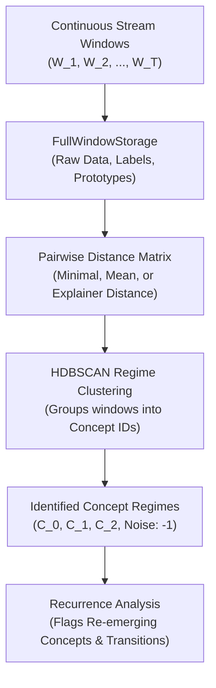

# Recurring Concepts & Prototypes

Streaming environments frequently exhibit recurring concepts where previously encountered distributions re-emerge after an inactive period (such as seasonal consumer behavior or macroeconomic regimes). STRIDE provides prototype-based concept memory to recognize historical states and avoid redundant retraining.

---

## Overview

When standard streaming detectors encounter concept drift, common practice is to discard the current model and train a replacement from scratch on incoming data. In recurring drift scenarios, this causes significant drawbacks:

1. **High Sample Complexity**: The model suffers elevated error rates during the cold-start retraining window.
2. **Historical Forgetting**: Knowledge acquired from prior occurrences of the concept is lost.

STRIDE introduces prototype-based concept memory that stores compact structural representations of stream windows and groups them into historical concept regimes using density clustering.

---

## Architecture of Concept Memory

The recurring concept tracking subsystem consists of three integrated components:



### 1. Prototype Representations (`ProTree`)
Comparing entire raw datasets across dozens of stream windows is computationally prohibitive ($O(N^2 \cdot T^2)$). STRIDE extracts compact prototype vectors per class using Prototype Trees (**`ProTree`**). Each prototype represents a centroid or exemplar summarizing the local manifold of that class within the window.

### 2. Window Storage (`FullWindowStorage`)
`FullWindowStorage` maintains window snapshots across the stream lifetime, indexing:
* Feature matrix $X_t$ and labels $y_t$.
* Class prototypes extracted by `ProTree`.
* Fitted surrogate decision tree explainers.
* Sequential detector drift flags.

### 3. Pairwise Distance Matrices
Given $T$ archived windows, `FullWindowStorage.compute_distance_matrix()` computes a symmetric distance matrix $D \in \mathbb{R}^{T \times T}$. Supported measures include:

* **`"minimal_distance"`**: Minimum Euclidean distance between prototype sets across corresponding classes:
  $$d_{\min}(W_a, W_b) = \min_{p_a \in P_a, p_b \in P_b} \| p_a - p_b \|_2$$
* **`"mean_distance"`**: Average pairwise Euclidean distance between prototype sets.
* **`"explainer_distance"`**: Structural dissimilarity between the decision paths of fitted surrogate explainers.

### 4. Regime Discovery via HDBSCAN
STRIDE applies **HDBSCAN** (*Campello et al., 2013*) to the precomputed distance matrix:

* **Automatic Cluster Discovery**: Determines the number of active concept regimes without requiring a predefined $K$.
* **Robust Noise Handling**: Transient transition windows or anomaly spikes are flagged as noise (`-1`) rather than corrupting established concept clusters.
* **Outlier Correction (`fix_outliers=True`)**: Reassigns isolated noise windows to their nearest persistent regime if surrounded by stable concept assignments.

---

## Python API Usage

```python
import numpy as np
from stride.datasets import SeaDriftDataset
from stride.xai.recurrence import (
    FullWindowStorage,
    cluster_windows,
    get_drift_from_clusters,
)

# 1. Initialize concept storage
storage = FullWindowStorage()

# 2. Simulate multi-window stream with alternating concepts (0 -> 1 -> 0 -> 1)
dataset = SeaDriftDataset()
concepts = [0, 1, 0, 1]

for iteration, concept_idx in enumerate(concepts):
    # Generate window from specific SEA concept variant
    X_batch, y_batch = dataset.generate(
        n_samples_before=200,
        n_samples_after=0,
        random_seed=42 + iteration,
    )

    # In practice, prototypes are extracted via ProTree or class centroids
    class_0_proto = X_batch[y_batch == 0].mean(axis=0).values
    class_1_proto = X_batch[y_batch == 1].mean(axis=0).values
    prototypes = {0: [class_0_proto], 1: [class_1_proto]}

    storage.store_window(
        iteration=iteration,
        x=X_batch,
        y=y_batch,
        prototypes=prototypes,
        explainer=None,
        drift=(iteration > 0 and concepts[iteration] != concepts[iteration - 1]),
    )

# 3. Compute pairwise window distance matrix
dist_matrix = storage.compute_distance_matrix(measure="minimal_distance")

# 4. Cluster windows into recurring concept regimes
cluster_labels = cluster_windows(dist_matrix, fix_outliers=True)
drift_points = get_drift_from_clusters(cluster_labels)

print("Pairwise Distance Matrix shape:", dist_matrix.shape)
print("Assigned Concept Cluster IDs: ", cluster_labels)
print("Detected Transition Steps:    ", drift_points)
```

### Interpreting Recurrence Results

* **Matching Cluster IDs**: If windows $W_0$ and $W_2$ share cluster ID `0`, and windows $W_1$ and $W_3$ share cluster ID `1`, STRIDE has confirmed that concept 0 re-emerged at iteration 2.
* **Transition Points**: `get_drift_from_clusters()` returns the timestamps where the assigned concept ID transitioned, providing empirical validation of concept recurrence cycles.
